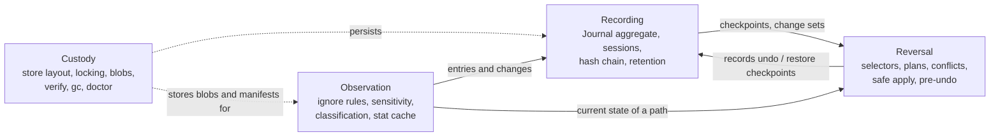

# Domain language

These terms mean the same thing in the code (type and function names), the tests and
the README. If a term here changes, change it everywhere.

## Glossary

| Term | Meaning | Where it lives |
|---|---|---|
| **Project** | The directory being observed. Its canonical path is the **project root**. | `StoreDir.root` |
| **Store** | Everything agent-undo keeps about one project: journal, manifests, blobs, key. By default outside the project. | `layout.rs`, `fs_*` adapters |
| **Entry** | The recorded state of one path: kind, mode, size, mtime, ctime and an id. Immutable value with validated construction. | `domain::entry::Entry` |
| **Kind** | `file` (content stored), `too-large` (hash only), `sensitive` (keyed hash only), `symlink`, `dir`, `special` (FIFO, socket, device), `unreadable`. | `domain::entry::Kind` |
| **RelPath** | A validated project-relative path (no `..`, no absolute, no NUL). The only path type that reaches restore code. | `domain::path::RelPath` |
| **Manifest** | The full state of the project after a checkpoint: a sorted list of path -> entry. | `SnapshotRepository` |
| **Change** | One path whose entry differs between two states: `created`, `modified`, `deleted` or `mode-changed`. | `domain::change::Change` |
| **Change set** | The changes a checkpoint recorded, with the before and after entry of each. | `SnapshotRepository` |
| **Blob** | Stored content of a regular, non-sensitive file, addressed by its SHA-256. | `BlobStore` |
| **Sensitive file** | A file whose name or content matches a secret detector. Its content is never stored; only size and a **keyed id** (HMAC of its hash) are recorded. | `domain::secrets`, `domain::policy` |
| **Checkpoint** | A numbered point in the history (`#1`, `#2`, ...): the manifest after it, the change set that led to it, and metadata. | `domain::journal::CheckpointRecord` |
| **Baseline** | Checkpoint `#1`, recorded by `init`. The only checkpoint without a predecessor. | `CkptKind::Baseline` |
| **Run checkpoint** | Records one wrapped command: its change set, exit status and command line. | `CkptKind::Run` |
| **External checkpoint** | Changes found by the snapshot before a run that no recorded run made (edits by hand, other tools). | `CkptKind::External` |
| **Session** | A run of consecutive checkpoints that are undone together by `undo --session`. A new session starts with `--new-session`. | `domain::journal::SessionId` |
| **Journal** | The aggregate: the hash-chained, append-only list of checkpoint records plus the pruned set. Protects the history invariants. | `domain::journal::Journal` |
| **Hash chain** | Each record contains the hash of its predecessor; any edit, removal or reordering is detectable. | `CheckpointRecord::compute_hash` |
| **Selector** | What to undo: a checkpoint, the last one that changed something, or a session. | `domain::journal::Selector` |
| **Plan** | The result of planning an undo or restore: one **plan item** per affected path. Nothing changes while planning. | `domain::plan::Plan` |
| **Target / expected / current** | Target: the state to restore. Expected: what the recorded change left behind. Current: what is on disk now. | `domain::plan::PlanItem` |
| **Conflict** | Current differs from expected: something other than the recorded change touched the path. Needs `--force`. | `Status::NeedsForce` |
| **Not restorable by design** | The plan item touches a sensitive file, a too-large file or a special file; it is reported and never modified. | `Status::NotRestorable` |
| **Blocked** | Refused for safety: a symlinked parent, a special file in the way, an obstruction nobody resolves. Even `--force` does not apply it. | `Status::Blocked` |
| **Obstruction** | An ancestor of a planned path is currently a file; resolved only if another item restores that ancestor as a directory. | `Observation::Obstructed` |
| **Pre-undo checkpoint** | The automatic snapshot of the current state recorded before an undo or restore changes anything, so the reversal is itself undoable. | `CkptKind::PreUndo` |
| **Dry run / apply** | Reversals and `gc` only preview by default; `--apply` changes things. | CLI |
| **Retention policy** | `keep last N` or `older than D`; the newest checkpoint is never pruned. | `domain::journal::RetentionPolicy` |
| **Pruned** | A checkpoint removed by `gc`: its record stays in the chain, its manifest, change set and unreferenced blobs are gone. | `Journal::prune` |
| **Known sensitive content** | The set of keyed ids of every content ever classified as sensitive; a file whose content matches is sensitive under any name. | `domain::policy::SensitiveIds`, `infra::fs_sensitive` |
| **Degraded directory** | A directory (or the project root) whose contents are not recorded because it is too large, too deep or could not be listed; its previous entries are carried forward. | `ScanVisitor::carry_forward` |
| **Redaction** | Replacing secret-looking parts of recorded command lines and labels with `[redacted]`. | `domain::redact` |
| **Verify** | Re-check of the chain, every checkpoint file digest and every blob hash. | `usecases::verify` |
| **Stat cache** | Re-use of a previous entry when size, mtime and ctime match and are older than the previous snapshot minus a margin. | `domain::policy::cache_usable` |
| **Quiet period** | `watch` records a checkpoint only after the pending change set stopped changing for this long. | `domain::watch::Debouncer` |
| **Fingerprint** | Order-independent hash of a pending change set, used by `watch` to detect that it is still changing. | `domain::change::fingerprint_step` |
| **Port** | A trait the application layer needs from the outside (clock, journal repository, working tree, ...). | `app::ports` |
| **Adapter** | An implementation of a port: filesystem, process, system clock. | `agent-undo-infra` |

## Bounded contexts

* **Observation** turns a directory into entries. Rules: default and user ignore
  patterns, sensitive names and content detectors, size cap, symlinks recorded not
  followed, stat cache. Published language: `Entry`, `Kind`, `Change`.
* **Recording** owns history. Rules: contiguous numbering, tamper-evident chain,
  baseline first, sessions, references of undo records, retention. Published language:
  `CheckpointRecord`, `DomainEvent`.
* **Reversal** decides and executes undo and restore. Rules: conflicts, by-design
  refusals, never leave the project root, never follow symlinks, order of operations,
  pre-undo snapshot. It is a *customer* of Recording and Observation: it reads
  checkpoints and asks for the current state of single paths; it never writes history
  directly but asks Recording to add the `pre-undo` and `undo` checkpoints.
* **Custody** is the supporting context for durability and integrity (private
  permissions, atomic writes, locking, verify, garbage collection). It implements the
  persistence ports and has no business rules of its own beyond file layout.

Relationships: Reversal -> Recording and Reversal -> Observation are
customer/supplier (the supplier's model is used as is, nothing is translated).
Custody conforms to the ports defined by the application layer (it is a plug-in).

## Domain events

| Event | Raised when |
|---|---|
| `SessionStarted` | The journal opens session 1 (baseline) or a record requests a new session. |
| `CheckpointRecorded` | A record was sealed into the journal. |
| `CheckpointsPruned` | `gc` removed checkpoints (only when at least one was removed). |
| `SensitiveContentWithheld` (application) | A change left a path recorded as `sensitive`. |
| `CommandFinished` (application) | The wrapped command of a `run` ended. |
| `ReversalApplied` / `ReversalRefused` (application) | An undo or restore changed the project / was refused and changed nothing. |
| `GarbageCollected` (application) | `gc --apply` removed checkpoints or blobs. |
| `WatchCommitted` (application) | `watch` recorded a checkpoint after a quiet period. |
